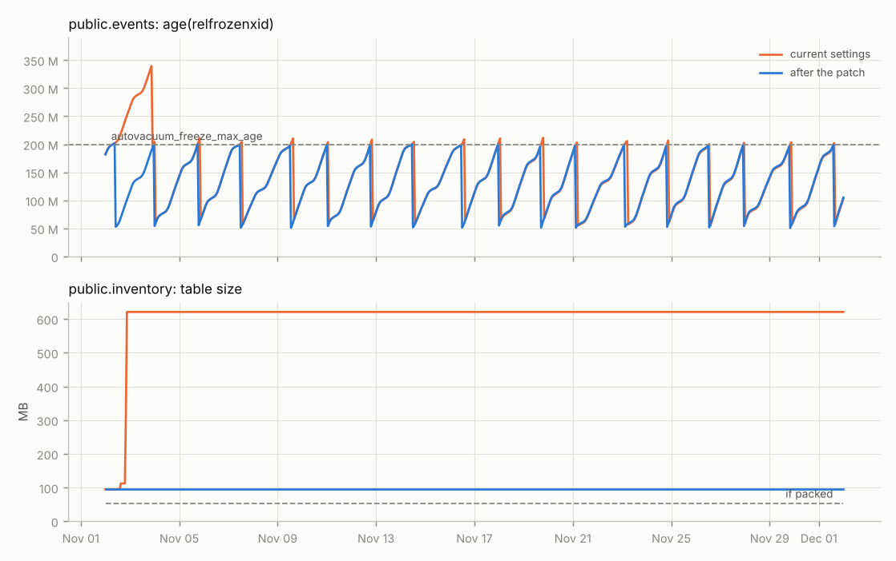

# keepup

Will autovacuum keep up next quarter?

keepup is a discrete-event simulator of PostgreSQL autovacuum. You give it
each table's change rates and your settings. It steps the launcher, the
workers and the shared cost throttle forward one vacuum at a time and
reports, per table, how bloat and transaction ID age will move over the next
few months. It can also search for settings that fix what it finds without
going over an I/O budget, and write them out as SQL.



Usually you find out autovacuum is behind when a dashboard goes red. By then
a table has been bloating for weeks, or an anti-wraparound vacuum has held a
worker for a day. Guessing the fix is risky too, because the knobs interact.
`autovacuum_vacuum_cost_limit` is shared by every running worker, so raising
`autovacuum_max_workers` on its own splits the same I/O budget into smaller
pieces and nothing finishes sooner. A per-table cost limit takes that table
out of the shared pool, so it adds I/O on top of the budget instead of
drawing from it. Each of these is easy to state and hard to keep in your head
across a few hundred tables. I wanted something that runs the next 90 days
and tells me which table breaks first.

## Example

`examples/upgraded.toml` is a made-up e-commerce database that came through
pg_upgrade from 11 with its old `autovacuum_vacuum_cost_delay = 20ms` still
in postgresql.conf (12 changed the default to 2ms).

```
$ keepup forecast examples/upgraded.toml
table               verdict  size                  bloat       vacuums            max xid age  p95 wait  longest run
------------------  -------  --------------------  ----------  -----------------  -----------  --------  -----------
public.users        ok       4,300 MB -> 4,938 MB  28% -> 17%  79 (2 anti-wrap)   206M         59s       106min
public.orders       behind   7,600 MB -> 15 GB     9% -> 20%   315                197M         58s       2.1h
public.order_items  ok       13 GB -> 18 GB        17% -> 1%   57 (57 anti-wrap)  213M         61s       2.9h
public.sessions     behind   1,100 MB -> 2,371 MB  36% -> 70%  14131              55M          57s       34min
public.inventory    behind   95 MB -> 621 MB       44% -> 91%  52245              55M          116s      10min
public.events       behind   566 GB -> 809 GB      12% -> 0%   57 (57 anti-wrap)  339M         3min      38.0h

  public.users: 2 anti-wraparound vacuums, about one every 45.0d

  public.orders: bloat grows from 9% to 20% (+8,259 MB on disk)

  public.order_items: 57 anti-wraparound vacuums, about one every 37.9h

  public.sessions: bloat grows from 36% to 70% (+1,271 MB on disk)

  public.inventory: bloat grows from 44% to 91% (+526 MB on disk)

  public.events: xid age overshoots autovacuum_freeze_max_age by 70%; 57 anti-wraparound vacuums, about one every 37.9h; longest run 38.0h

workers busy 36% on average, all of them busy 9.6% of the time, p99 vacuum i/o 5.7 MB/s
```

Three large tables cross `autovacuum_freeze_max_age` within the first day,
so all three workers go to anti-wraparound vacuums at once. At 20ms per nap
the one on the 566 GB event log takes 38 hours, long enough for its xid age
to run 70% past the limit. Meanwhile `inventory` and `sessions`, which turn
over every couple of minutes, sit and wait. The dead rows they collect in
that hour become bloat the table keeps for the rest of the quarter, because
a file doesn't shrink back. That's the jump in the chart at the top.

`tune` tries changes one knob at a time against the same simulation and
keeps the best, until nothing helps:

```
$ keepup tune examples/upgraded.toml --io-budget 120MB/s --days 20 --out out/upgraded
-- keepup settings patch, 2026-11-04 15:59 UTC
-- profile examples/upgraded.toml, searched over 20 days, i/o budget 120 MB/s
-- before: score -5.699: bloat -28.13 GB avg, wraparound 0.45, lag 0.20, peak i/o 6.2 MB/s
-- after:  score -31.334: bloat -31.41 GB avg, wraparound 0.00, lag 0.03, peak i/o 37.9 MB/s

-- server settings. ALTER SYSTEM writes postgresql.auto.conf
ALTER SYSTEM SET autovacuum_naptime = '15s';  -- was '60s'
ALTER SYSTEM SET autovacuum_vacuum_cost_delay = '0.5ms';  -- was '20ms'
SELECT pg_reload_conf();

-- per table. ALTER TABLE ... SET takes a SHARE UPDATE EXCLUSIVE lock,
-- which conflicts with a running vacuum on that table; a normal autovacuum
-- gets cancelled, an anti-wraparound one makes you wait. lock_timeout
-- keeps it from queueing behind one.
SET lock_timeout = '5s';
ALTER TABLE public.orders SET (autovacuum_vacuum_scale_factor = 0.005);
RESET lock_timeout;
```

With those three changes every table comes out "ok" over 90 days, at a p99 of
38 MB/s of vacuum I/O. The score is a weighted sum (bloat added, xid age past
the limit, time spent waiting for a worker, a small charge per change) and
only matters relative to the baseline. `--out` writes `report.html` with the
summary, the patch and charts for every table, the same report for the
current settings under `before/`, `summary.json` and `patch.sql`.

## Using it on a real server

The sampler needs a role that can read the statistics views, for example a
member of `pg_monitor`. Row widths come from `pg_stats`, which only shows
tables the role can `SELECT`. Without widths keepup assumes the tables have
no bloat today, so the forecast starts optimistic.

1. Sample for a while. A day of samples gives a daily pattern; two weeks
   gives weekly patterns and a growth rate.

   ```
   keepup profile sample --all-databases --dsn "host=db1 user=monitor dbname=postgres" \
       --interval 60s --duration 14d --out samples.jsonl
   ```

   It runs in autocommit and reads the next xid from `pg_current_snapshot()`,
   so it holds no snapshot between samples and doesn't consume xids itself.

2. Log autovacuum runs if you don't already. `log_autovacuum_min_duration = 0`
   logs everything; a few seconds is fine on a busy server. The logs are how
   keepup learns how fast vacuum gets through pages on your hardware.

3. Fit a profile and check it against what the server did over the same
   window.

   ```
   keepup profile fit samples.jsonl --logs /var/log/postgresql/*.log --out profile.json
   keepup calibrate --samples samples.jsonl --logs /var/log/postgresql/*.log
   ```

4. Forecast, try changes, or let it search.

   ```
   keepup forecast profile.json --days 90 --runs 20 --out report/
   keepup forecast profile.json --set autovacuum_vacuum_cost_limit=1000 \
       --table-set public.orders:autovacuum_vacuum_scale_factor=0.02
   keepup tune profile.json --io-budget 150MB/s --out tune/
   ```

`--runs N` adds p10/p90 bands from N runs with noisy rates (the noise level
comes from the fit; `--noise 0.2` sets one for hand-written profiles).
`forecast --exit-code` exits 1 if a table falls behind and 2 if one heads for
wraparound trouble, if you want to run it in CI against a checked-in profile.

A profile is plain data. You can write one by hand in TOML to try an idea
before there's a server to sample; `examples/shop.toml` has the fields, with
the optional ones listed at the bottom.

## How close is it

The lab (`lab/`) drives a real server with known insert, update and delete
rates, samples it the way the profiler would, and splits the run in half.
Everything keepup knows comes from the first half: rates, the I/O model, the
per-table parameters. Starting from the server's state at the midpoint, it
predicts the second half, which then gets compared with the autovacuum log.

Two 40 minute scenarios on PostgreSQL 16. Over tables with three or more
vacuums in the predicted half:

| scenario | what's in it | vacuum count | gap between vacuums | duration |
|---|---|---|---|---|
| basic | HOT updates, append-only, a queue, forced anti-wraparound | 0% off | 0% | 37% |
| churn | non-HOT updates, ~40% cache misses, 2-3 workers sharing a cost limit of 40 | 1% | 2% | 10% |

Most of the 37% is a queue table whose vacuums take 40ms, logged at 10ms
resolution. [docs/validation.md](docs/validation.md) has the per-table
numbers, the charts, and the list of things the lab caught in the model on
the way there (four real ones). The lab only covers minutes of wall clock
on small tables; it says the mechanics are right, not that a 90 day
forecast for your database will be.

## How it works

[docs/model.md](docs/model.md) goes through it piece by piece with pointers
into the postgres source. In short: rates are piecewise constant per hour, so
each table's counters are exact lookups on cumulative curves and a table is
only computed when an event looks at it. Events are launcher wake-ups and
vacuum completions. The launcher, the worker table lists, the cost balancing
across workers, `vacuum_delay_point`'s sleep, the visibility map skipping
rule, index passes, freezing and the way `n_dead_tup` gets overwritten after
each run all follow the PG 16 source, with the differences in 13 to 18 noted
where they matter. A quarter for a few dozen tables takes seconds, which is
what makes the search practical.

## Known gaps

- TOAST, index bloat, heap truncation, multixact age and system catalogs are
  not modelled.
- Autovacuum getting cancelled by DDL or `LOCK TABLE` isn't either. On a
  schema that changes a lot the forecast will be too optimistic.
- Cache hit ratio is a fixed number per table. A vacuum that blows out the
  cache for everyone else won't show up.
- The pg17+ dead tuple store size is an estimate (48 bytes per heap page with
  dead items), so index pass counts on 17 and 18 are less certain than on 16.
- Growth is linear and fitted from two weeks at most. A quarter is a long way
  to extrapolate; the bands only cover hourly noise, not a wrong trend.

## Development

```
make dev        # venv + editable install with dev deps
make check      # ruff, mypy --strict, pytest
make lab-local  # validation lab against a throwaway cluster, needs postgres binaries
```

`tests/test_pg.py` runs against a real server when `KEEPUP_TEST_DSN` is set.
CI also runs the short lab scenario against 14, 16 and 17 in Docker.
