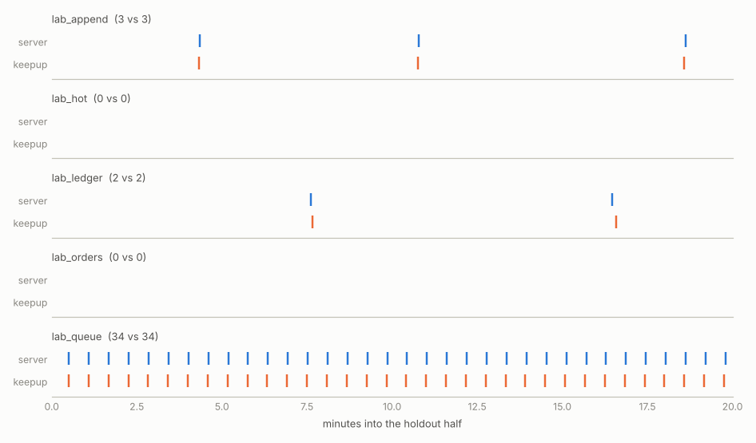
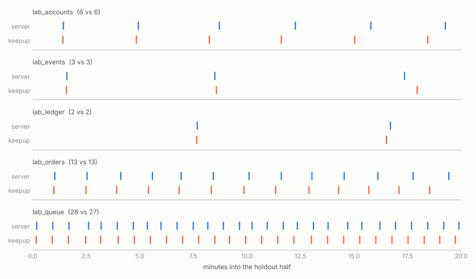

# Validation

The lab runs a real server, drives each table at a known insert, update and
delete rate, and samples it the same way `keepup profile sample` would. The
run is split in half:

- From the first half only: fit the rates from the samples, fit the
  throughput model and the per-table parameters (cache hit, dirty share,
  active fraction) from the autovacuum log.
- Take the table state from the sample at the midpoint and simulate the
  second half.
- Compare with what the server logged in the second half: vacuums per table,
  the median gap between them, median duration and pages scanned.

Nothing from the second half goes into the prediction. The settings are
cut down (5 second naptime, a cost limit of 120 or 40) so 40 minutes covers
dozens of vacuums per table and the workers have to share the budget.

## Results

Two 40 minute runs on PostgreSQL 16, local cluster, 256MB `shared_buffers`,
3 workers. Measured rates came out within 0.3% of the scenario's targets on
every table, so the profiler side is not where the error comes from.

### basic.toml

Mostly HOT updates on an unindexed column, an append-only table, a queue,
and a quiet table with `autovacuum_freeze_max_age = 100000` to force
anti-wraparound vacuums every nine minutes. Cost limit 120.



| table | vacuums (server / keepup) | median gap, s | median duration, s | pages scanned |
|---|---|---|---|---|
| append | 3 / 3 | 428 / 428 | 1.14 / 0.98 | 7709 / 9050 |
| hot | 0 / 0 | | | |
| ledger | 2 / 2 | 531 / 535 | 2.54 / 2.72 | 6650 / 6650 |
| orders | 0 / 0 | | | |
| queue | 34 / 34 | 35.0 / 35.0 | 0.04 / 0.06 | 725 / 625 |

`hot` and `orders` never get vacuumed: their updates are HOT, pruning keeps
`n_dead_tup` flat at about one row per page, and only autoanalyze runs. The
simulator gets there from the fitted dead-row yield, without being told.
The queue's 40ms runs are at the 10ms resolution of the log, which is most
of the duration error on that table.

### churn.toml

Non-HOT updates on an indexed column, bigger tables (accounts 150MB, orders
400MB) and a cost limit of 40, so runs take 10 to 60 seconds and two or
three workers share 40 credits per 2ms between them. About 40% of vacuum
reads miss shared buffers.



| table | vacuums (server / keepup) | median gap, s | median duration, s | pages scanned |
|---|---|---|---|---|
| accounts | 6 / 6 | 211 / 205 | 39.5 / 43.4 | 19163 / 22834 |
| events | 3 / 3 | 472 / 491 | 45.1 / 44.8 | 20357 / 27190 |
| ledger | 2 / 2 | 541 / 531 | 14.5 / 6.8 | 6651 / 6651 |
| orders | 13 / 13 | 90.2 / 87.5 | 10.8 / 10.4 | 5443 / 5534 |
| queue | 28 / 27 | 45.0 / 45.0 | 1.44 / 1.06 | 1492 / 1327 |

Across tables with three or more runs: vacuum counts 1% off, gaps 2%,
durations 10%. Ledger's anti-wraparound runs come out at half the real
duration; with two runs per half I haven't chased it.

### What the lab changed

None of the numbers above are what the first version of the simulator
produced. The runs turned up, in order:

- appended pages were treated as scattered, so the 32-page skip rule made
  an append-only vacuum read most of the table (5x too many pages)
- the dead-row yield for HOT tables was fitted from the first minute,
  before pruning reached equilibrium
- anti-wraparound vacuums were assumed aggressive; with a per-table
  `autovacuum_freeze_max_age` they aren't
- the share of pages vacuum has to dirty was a per-table constant. It
  depends on how long pages stay dirty in memory, which is
  `checkpoint_timeout` on the basic run and close to zero on the churn run,
  where the background writer cleans pages before any checkpoint does. That
  one took durations from 2-4x off to 10%.

## Reproducing it

With Docker:

```
cd lab
docker compose up -d
keepup lab run scenarios/basic.toml --dsn "host=localhost port=54320 user=postgres dbname=postgres" --out runs/basic
docker compose logs --no-log-prefix pg > runs/basic/postgres.log
keepup lab analyse runs/basic --scenario scenarios/basic.toml --log runs/basic/postgres.log
```

Without it, if the server binaries are installed (`initdb`, `pg_ctl`):

```
lab/run-local.sh lab/scenarios/basic.toml
```

Each run directory ends up with `samples.jsonl`, `autovacuum.jsonl` (the
parsed log), `profile-mid.json` (what the prediction started from),
`sim-holdout.jsonl`, `result.json`, `report.md` and `holdout.png`.

The lab table names start with `lab_` and get dropped and recreated, and the
scenario's settings are applied with `ALTER SYSTEM`. Point it at a scratch
server.
